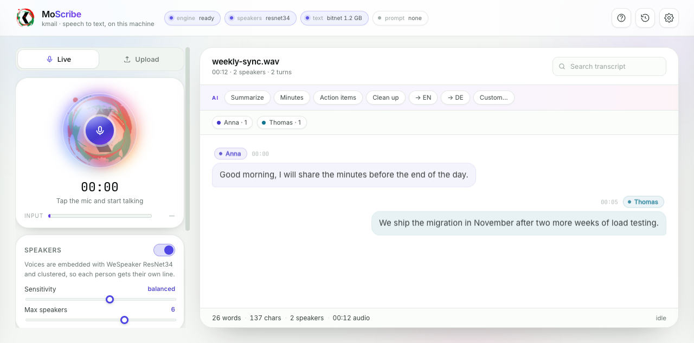

# MoScribe

**Local speech to text with speaker separation and on-device summaries.**
Nothing leaves your machine — no API keys, no uploads, no accounts.



MoScribe turns a microphone or an audio file into a transcript that knows *who* is
speaking, then writes summaries, minutes and action items with a small model that
runs on the same CPU. It is one local web app: a FastAPI server and a no-build-step
interface, wrapping [VibeASR.cpp](https://github.com/microsoft/VibeASR.cpp) for
recognition and llama.cpp for text. Built by [kmail.at](https://kmail.at).

## Download

Direct links — they always point at the newest release:

| Platform | Download | Size |
| --- | --- | --- |
| **macOS · Apple silicon** | [MoScribe-macos-arm64.dmg](https://github.com/mokmail/moscribe/releases/latest/download/MoScribe-macos-arm64.dmg) | ~47 MB |
| **macOS · Intel** | [MoScribe-macos-x64.dmg](https://github.com/mokmail/moscribe/releases/latest/download/MoScribe-macos-x64.dmg) | ~48 MB |
| **Windows 10/11 x64** | [MoScribe-windows-x64-setup.exe](https://github.com/mokmail/moscribe/releases/latest/download/MoScribe-windows-x64-setup.exe) | ~45 MB |
| **Linux x64** | [MoScribe-linux-x64.tar.gz](https://github.com/mokmail/moscribe/releases/latest/download/MoScribe-linux-x64.tar.gz) | ~45 MB |
| Windows (portable, no installer) | [MoScribe-windows-x64.zip](https://github.com/mokmail/moscribe/releases/latest/download/MoScribe-windows-x64.zip) | ~45 MB |
| Engines only (for a pip install) | `moscribe-<platform>-bin.zip` — fetched automatically by `moscribe --fetch-models` | ~4 MB |

All releases, checksums and older versions:
[github.com/mokmail/moscribe/releases](https://github.com/mokmail/moscribe/releases).

The installers contain the app, the interface and the native engines — **not** the
models. The first run downloads those once (~2.8 GB), see
[First run: the models](#first-run-the-models).

## Install

MoScribe is a desktop app that runs entirely on your machine. Pick the line that
matches your system — every option ends with the same two commands.

Everything is built by [the release workflow](.github/workflows/release.yml). The macOS
arm64 build is the reference target; the other platforms are produced by the same
workflow and may land a few minutes after it.

### Requirements

| | |
| --- | --- |
| OS | macOS 12+ (Apple silicon or Intel), Windows 10/11 x64, Linux x64 (glibc 2.31+), or any Docker host |
| CPU | any x86-64 or Apple-silicon CPU — no GPU, no CUDA, no Metal needed |
| RAM | 8 GB free (models stay resident: about 3 GB) |
| Disk | ~3 GB for models, plus your recordings and transcripts |
| Network | only for the one-time model download |

### macOS

1. Download [`MoScribe-macos-arm64.dmg`](https://github.com/mokmail/moscribe/releases/latest/download/MoScribe-macos-arm64.dmg) (Apple silicon) or
   [`MoScribe-macos-x64.dmg`](https://github.com/mokmail/moscribe/releases/latest/download/MoScribe-macos-x64.dmg) (Intel) from [Releases](https://github.com/mokmail/moscribe/releases).
2. Open the `.dmg` and drag **MoScribe** into *Applications*.
3. First launch only: the build is not notarised, so macOS blocks it. Right-click the
   app → **Open** → **Open**, or allow it under *System Settings → Privacy & Security*
   ("Open Anyway").
4. Allow the microphone when asked — the app records locally; nothing is uploaded.
5. Fetch the models once, then start it:

   ```bash
   /Applications/MoScribe.app/Contents/MacOS/MoScribe --fetch-models
   /Applications/MoScribe.app/Contents/MacOS/MoScribe
   ```

### Windows

1. Download [`MoScribe-windows-x64-setup.exe`](https://github.com/mokmail/moscribe/releases/latest/download/MoScribe-windows-x64-setup.exe) from
   [Releases](https://github.com/mokmail/moscribe/releases) and run it.
2. The installer is unsigned, so SmartScreen shows "Windows protected your PC" —
   click **More info → Run anyway**.
3. If you picked the desktop shortcut option, launch it; otherwise use the Start-menu
   entry **MoScribe**.
4. Open a terminal once for the models:

   ```powershell
   & "C:\Program Files\MoScribe\MoScribe.exe" --fetch-models
   ```

   (or `moscribe --fetch-models` if the folder is on your `PATH`).
5. Launch MoScribe again and allow microphone access.

### Linux

```bash
curl -LO https://github.com/mokmail/moscribe/releases/latest/download/MoScribe-linux-x64.tar.gz
tar -xzf MoScribe-linux-x64.tar.gz
cd MoScribe
./MoScribe --fetch-models     # once, ~2.8 GB
./MoScribe                    # opens http://127.0.0.1:8770
```

The tarball also ships `share/applications/moscribe.desktop` and a 512 px icon — copy
them to `~/.local/share/applications/` and `~/.local/share/icons/` to get a launcher
entry. Keep the `_internal/` folder beside the executable: it holds the engines
(`_internal/bin/`), the interface and the Python runtime.

### Docker (server, NAS, headless)

The fastest path if you already run containers — the image builds the engines for you:

```bash
docker compose up -d          # or: docker run -d -p 8770:8770 -v moscribe-data:/data moscribe
```

Open `http://<host>:8770`. Models download into the `moscribe-data` volume on first
start. Set `MOSCRIBE_SKIP_FETCH=1` to manage the download yourself, and
`MOSCRIBE_HOST=0.0.0.0` when you want it reachable from another machine.

### From source (any OS)

Needs Python 3.10+, CMake and a C++17 compiler:

```bash
git clone https://github.com/mokmail/moscribe
cd moscribe
python3 -m venv .venv
.venv/bin/pip install -e ".[dev]"
.venv/bin/moscribe --fetch-models
.venv/bin/moscribe
```

On Windows use `.venv\Scripts\pip` and `.venv\Scripts\moscribe.exe`.
Building the native engines from scratch is covered in [docs/BUILD.md](docs/BUILD.md).

### First run: the models

The app ships without weights — they would triple the installer size.

```bash
moscribe --fetch-models      # ~2.8 GB, resumable, straight from Hugging Face
moscribe --check             # confirm every binary and model is found
```

| Model | Purpose | Size |
| --- | --- | --- |
| VibeVoice-ASR-BitNet (VAE + LM) | speech recognition | 1.6 GB |
| BitNet b1.58 2B-4T | summaries, minutes, rewrites | 1.1 GB |
| WeSpeaker ResNet34 | speaker voiceprints | 25 MB |

Downloads land in your user data folder (`MOSCRIBE_DATA` overrides it):

| OS | Where |
| --- | --- |
| macOS | `~/Library/Application Support/MoScribe/models` |
| Windows | `%LOCALAPPDATA%\MoScribe\models` |
| Linux | `~/.local/share/moscribe/models` |
| Docker | the `/data` volume |

Already have the GGUFs on a USB disk or a shared server? Point at them and skip the
download: `MOSCRIBE_MODELS=/path/to/models moscribe`. The layout mirrors the table
above (`vibeasr/`, `llm/`, `spk/`).

### Verify the install

```bash
moscribe --check
```

```
MoScribe — ready
  app_dir    …/MoScribe/_internal
  data_dir   ~/Library/Application Support/MoScribe
  models_dir ~/Library/Application Support/MoScribe/models
  frozen     True
```

`ready` means the engines and all three models were found. `incomplete` prints exactly
what is missing.

### Upgrade / uninstall

Upgrade by installing the newer package over the old one — your history and models are
untouched in the data folder.

Uninstall: delete the app (or run the Windows uninstaller). To remove everything,
delete the data folder as well. On macOS:

```bash
rm -rf "/Applications/MoScribe.app" "$HOME/Library/Application Support/MoScribe"
```

### If something goes wrong

| Symptom | Fix |
| --- | --- |
| `missing binary: asr_stream_server` | the bundle was built without `bin/`, or the engines failed to compile — run `moscribe --fetch-models`, which pulls the published `-bin.zip` |
| `missing model: …` | re-run `moscribe --fetch-models`; interrupted downloads resume from `.part` files |
| Engine exits with `Library not loaded` | rpaths were not rewritten when packaging — see [docs/BUILD.md](docs/BUILD.md) step 2 |
| macOS: "app is damaged" | the ad-hoc signature was stripped by the browser; re-download, or `xattr -dr com.apple.quarantine /Applications/MoScribe.app` |
| Windows: SmartScreen blocks the setup | **More info → Run anyway** (unsigned build) |
| Microphone permission denied | macOS: *System Settings → Privacy & Security → Microphone*; browser-only tabs also need the site permission |
| Port 8770 busy | `moscribe --port 8780` picks the next free port automatically |
| First transcription is slow | models load lazily; the app warms them at boot, or call `POST /api/engine/warmup` |

## Use

Start it (`moscribe`, or the app icon); it opens `http://127.0.0.1:8770`.

- **Live** — press the orb or <kbd>Space</kbd>. Speech lands every 8–10 s. Press
  again to stop: the tail window still transcribes, and a `transcribing` chip stays
  up until the transcript is genuinely final.
- **Upload** — drop wav, mp3, m4a, flac, ogg or mp4 (max 600 MB).
- **Speakers** — WeSpeaker voiceprints plus clustering give each voice a colour and
  a name you can rename inline; names carry into copy/export.
- **Prompts** — ten presets (meeting, stand-up, interview, lecture, Austrian public
  sector, clinical, legal, support, podcast, workshop) or your own context, to bias
  recognition toward names and jargon.
- **Layouts** — the transcript follows the template: chat bubbles for a meeting,
  prose for a lecture, Q&A for an interview, cards or a compact log. Override in
  Settings → Prompt.
- **AI actions** — summarize, minutes, action items, clean up, translate, or ask your
  own question. Results stream into the side panel; copy, download, mail or share.
- **Machine panel** — live CPU/RAM sparklines, so you can see what the models cost.

Press <kbd>?</kbd> in the header for the in-app guide.

## How it works

```
mic / file
   │  24 kHz mono; windows cut at the quietest point near a boundary
   ▼
VAD ──► WeSpeaker ResNet34 (256-d voiceprints) ──► clustering = speakers
   │                                                    │
   ▼                                                    │
VibeASR.cpp (VibeVoice-ASR-BitNet, I8_S encoder + I2_S LM) ◄┘
   │  uploads are cut at speaker turns, so a label is right by construction
   ▼
stitching (sliding longest-run merge across the 2 s overlap)
   ▼
BitNet b1.58 2B-4T via llama.cpp → summaries, minutes, action items
```

| Piece | What it is | Size |
| --- | --- | --- |
| `asr_stream_server` | VibeASR.cpp streaming server (BitNet ASR) | 0.2 MB + dylibs |
| ASR weights | VibeVoice-ASR-BitNet VAE + LM (GGUF) | 1.6 GB |
| Speaker model | WeSpeaker ResNet34-LM (ONNX) | 25 MB |
| Text model | BitNet b1.58 2B-4T (GGUF, I2_S) | 1.1 GB |

About 0.3–0.6× real time for recognition on Apple silicon CPU; roughly 12 tokens/s
from the text model. Plain CPU code — no CUDA, no Metal requirement.

### Speaker separation

1. **VAD** — short-time energy with an adaptive noise floor splits audio into
   utterances at pauses.
2. **Embedding** — L2-normalised 256-d voiceprint per utterance (Kaldi-style 80-bin
   fbank, 16 kHz, per-utterance mean normalisation). Measured margin on four
   synthetic voices: +0.11 cosine within-vs-across speaker.
3. **Clustering** — average-linkage agglomerative + spherical k-means refinement,
   hard speaker cap, pruning of tiny clusters. Spans under 0.8 s never define a
   voice; they inherit their nearest neighbour.
4. **Alignment** — uploads are cut into windows *at speaker turns*, so a window
   belongs to one person by construction. Live windows can span two voices; those
   are split word-proportionally over the window's diarised spans.

Live dictation uses a stable online clusterer (persistent centroids, creation-order
labels) — re-clustering renumbered speakers mid-transcript.

### Text actions

Summaries, minutes, action items, cleanup and translation run on **BitNet b1.58 2B-4T**
through the llama.cpp build that ships with VibeASR.cpp (its ggml already registers
`LLM_ARCH_BITNET_B158` and has I2_S kernels, so no second toolchain). The app starts
`llama-server` on 127.0.0.1:8771 and warms it at boot.

Actions: `summarize`, `minutes`, `actions`, `rewrite`, `translate_en`, `translate_de`,
`custom`. English output is accurate and keeps speaker names. German *generation* is
not usable at 2.4 B — the model echoes or invents facts — so output stays English and
translation is marked experimental. Point `VIBESCRIBE_LLM_MODEL` at a larger
multilingual instruct GGUF (e.g. Qwen2.5-7B-Instruct Q4) for real German.

## Privacy

Audio, transcripts, summaries and history live in your user data directory:

| OS | Path |
| --- | --- |
| macOS | `~/Library/Application Support/MoScribe` |
| Windows | `%LOCALAPPDATA%\MoScribe` |
| Linux | `~/.local/share/moscribe` (or `$XDG_DATA_HOME`) |
| Docker | `/data` (the volume) |

Deleting a session in History removes its files. The only network access is the
one-time model download.

## API

| Endpoint | Purpose |
| --- | --- |
| `GET /api/health` | engine + speaker-model status |
| `GET /api/system` | CPU/RAM/load samples + short history |
| `POST /api/engine/warmup` | load models ahead of the first request |
| `POST /api/transcribe` | multipart upload → job id (progress over WS) |
| `POST /api/transcribe-sync` | upload → finished transcript (scripts, CI) |
| `WS /ws/jobs/{id}` | token / chunk / phase / done stream |
| `WS /ws/live` | 24 kHz mono WAV windows in, turns + `final` out |
| `POST /api/ai/stream` | `{action, transcript, extra, speakers}` → SSE |
| `GET|DELETE /api/history[/*]` | transcript history |

Form fields (`/api/transcribe`, `/api/transcribe-sync`): `threads`, `decoding`
(`greedy`|`sampling`), `temperature`, `top_p`, `context`, `prompt_format`
(`text`|`json`), `chunk_sec`, `overlap_sec`, `speaker_separation` (`on`|`off`),
`speaker_sensitivity` (0.55–0.95, default 0.78), `max_speakers` (2–8, default 6).

## Configuration

| Variable | Effect |
| --- | --- |
| `MOSCRIBE_DATA` | data directory (history, jobs, downloads) |
| `MOSCRIBE_MODELS` | model root |
| `MOSCRIBE_BIN` | engine binary directory |
| `MOSCRIBE_HOST` / `MOSCRIBE_PORT` | bind address / port |
| `VIBEASR_BIN`, `VIBEASR_MODELS` | override individual engine paths |
| `VIBESCRIBE_LLM_BIN`, `VIBESCRIBE_LLM_MODEL`, `VIBESCRIBE_LLM_PORT` | text engine |
| `MOSCRIBE_SKIP_FETCH=1` | Docker: never download models at start |

## Develop

```bash
python -m venv .venv && .venv/bin/pip install -e ".[dev]"
.venv/bin/moscribe --port 8770 --no-browser
```

Frontend is `moscribe/static/` — plain HTML/CSS/JS, no bundler, no npm. Backend is
`moscribe/`, one module per job:

| File | Role |
| --- | --- |
| `main.py` | routes, job runner, live WebSocket |
| `asr_engine.py` | supervises `asr_stream_server`, chunk planning, stitching |
| `diarization.py` | VAD, span grouping, clustering, turn building |
| `spk_embed.py` | WeSpeaker ONNX embedder (Kaldi-style fbank) |
| `llm.py` | supervises `llama-server`, prompt templates per action |
| `paths.py` | app/data/model locations, frozen vs checkout |
| `fetch.py` | first-run downloads |
| `moscribe_cli.py` | the `moscribe` command |

Building the engines, packaging installers and the release pipeline:
[docs/BUILD.md](docs/BUILD.md). Checks:

```bash
.venv/bin/python -m py_compile moscribe/*.py
node --check moscribe/static/app.js
.venv/bin/python scripts/test_diarization.py     # synthesises a 3-voice conversation
```

## License

MIT for MoScribe's own code — see [LICENSE](LICENSE). Upstream models and libraries
keep their own terms: [THIRD_PARTY.md](THIRD_PARTY.md). The kmail mark is not covered
by the MIT grant.
